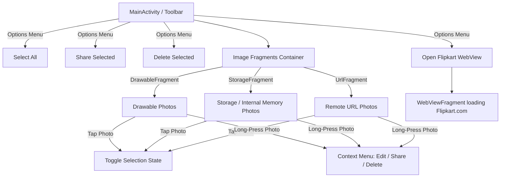

# Implementing Menus and WebView (Image Application)

An Android application demonstrating the implementation of Android Menus (Options Menu, Context Menu), Fragment-based layouts, interactive photo selection, and WebView integration (redirecting to Flipkart).

---

## Features

1. **Toolbar Options Menu**:
   - **Select All**: Selects all images across fragments.
   - **Share Selected**: Shares selected photos via Android share intents.
   - **Delete Selected**: Deletes/clears selected photos.
   - **Open Flipkart WebView**: Navigates to the embedded WebView displaying `https://www.flipkart.com`.

2. **Photo Management via Fragments**:
   - **DrawableFragment**: Displays local static drawable images.
   - **StorageFragment**: Allows picking and displaying images from device internal storage/memory.
   - **UrlFragment**: Loads and displays images from remote URLs (using Coil).

3. **Interactive Photo Interactions**:
   - **Tap**: Toggles selection state on individual photos (with visual opacity feedback).
   - **Long-Press**: Opens a Context Menu (`Edit`, `Share`, `Delete`) for the specific photo.

4. **WebView Integration**:
   - Embedded `WebView` utilizing JavaScript support and `WebViewClient` to seamlessly browse Flipkart within the app.

---

## App Flowchart

---

## Tech Stack

- **Language**: Kotlin
- **UI Architecture**: Fragments (`DrawableFragment`, `StorageFragment`, `UrlFragment`, `WebViewFragment`) inside `MainActivity`.
- **Image Loading**: Coil (`coil3`) for URL images.
- **Menus**: Android XML Menus (`main_menu.xml`, `context_menu.xml`).
- **Web Rendering**: Android `WebView` with `WebViewClient`.
